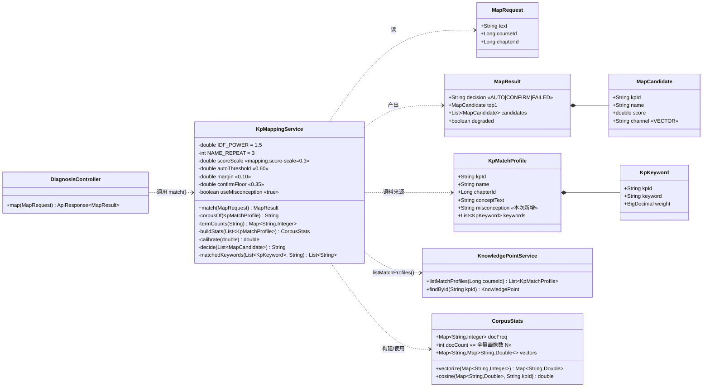
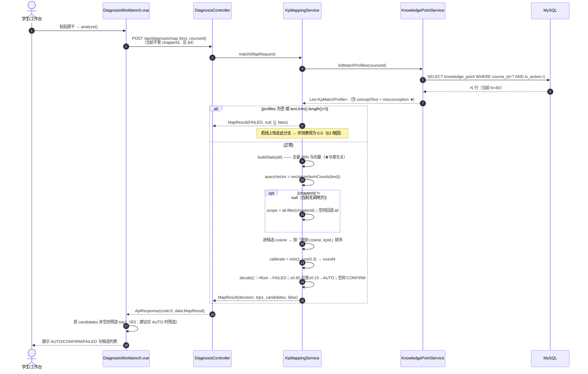
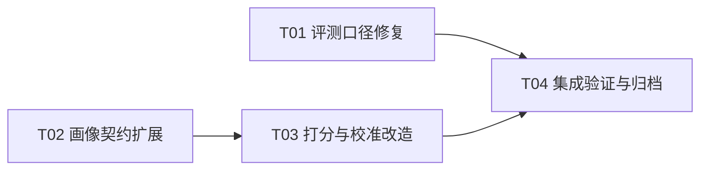

# 映射子系统审核与最优优化方案（错题 → 知识点）

- 版本：2026-11-03 / v1.0
- 作者：架构师（Bob）
- 审核对象：`KpMappingService`（`POST /api/diagnosis/map`）及其离线/在线评测链路
- 代码基线：worktree `_wt/mapping-eval-20261103`，分支 `ai/mapping-eval-20261103`，HEAD `612cc3c`
- 范围约束：不改公开契约（`docs/openapi.yaml`、`docs/01-接口契约V2.md`）、不改 DB schema、不新增生产依赖、`/api/diagnosis/map` 响应结构不变

> **2026-11-03 更正（D3/D4，以 `tools/testdata/MAPPING_EVAL_STATUS.md` 为准）**：
> 本文 §0(4)、§3.1、§5.3 中「同一 32 题同算法离线 top1 = 62.5%」的引用口径有误——该 62.5% 来自 `chapter_mode='hard'`（oracle，假设调用方传对章节）；**同算法、不传章**的口径为 V0 **56.2%**、V2 **62.5%**。§5.2 中 V11（U60）**63.3%** 系旧「按校准后 score 排序」口径，D3 修复后为 **65.0%**。结论不变：0.0 仍只能是零候选；V11 无增量。

---

## 0. 结论摘要（先看这 8 行）

| # | 结论 | 强度 |
|---|---|---|
| 1 | **`73.3%` 不是生产算法数字，但它对"20 个知识点"这个语料规模是忠实的。** 用 Java 语义（按原始 cosine 排序 + round4）复算，V0/V2 与脚本逐位一致（73.3%/81.7%）。 | 已实测证实 |
| 2 | **最大偏差不是打分公式，而是语料规模 N。** 脚本只读 `seed-kp-ch02-ch03.sql`（N=20）；生产 `listMatchProfiles` 返回课程全部启用点，当前种子是 **N=60**（ch01–ch06，见 `docker-compose.yml` 挂载）。同一 60 题在 N=60 下 V0 只有 **top1 55.0% / top3 73.3%**。 | 已实测证实 |
| 3 | **章硬过滤口径不一致（真缺陷）。** 脚本"全局 df 打分 → 再按章过滤"，Java"先裁剪 → 在章内重算 df/N"。同一 V6，脚本口径 AUTO 精确率 95.8%，Java 口径 **87.1%**。V6/V7/V10 的数字**不可迁移**到生产。 | 已实测证实 |
| 4 | **在线 0.0 与算法无关（可判定）。** 同一 32 题用同算法离线复刻得 top1 **62.5%**、top3 87.5%；若候选非空而全错，概率 ≈ `0.375^32 ≈ 2×10⁻¹⁴`。因此 0.0 = **候选全空**（或响应体未被评测脚本 walk 覆盖），属部署态/数据态问题。 | 已实测证实（排除法） |
| 5 | 0.0 的两个候选成因（**未验证，需命令**）：(a) `knowledge_point` 无 `course_id=1 AND is_active=1` 的行（`./data/mysql` 已存在导致 `docker-entrypoint-initdb.d` 不重跑）；(b) 请求体中文乱码使题干与全部语料零二元组交集，`cosine>0` 全被过滤。**"只有 init-v2 的 2 条冒烟 KP"已被排除**（该形态会产出 19 个 AUTO，与观测的 AUTO=0 矛盾）。 | 已排除一项，其余待验 |
| 6 | **章硬过滤当前零调用方。** `zhixue-web/src/api/diagnosis.ts:96-97` 只发 `{text, courseId}`；`DiagnosisWorkbench.vue` 无章节选择器（`grep chapter` 空）。`MAPPING_EVAL_STATUS.md:16` 称"诊断流已知题目所属章节"**是错误陈述**，必须更正。 | 已证实 |
| 7 | **推荐方案：V2（误区入语料）+ `mapping.confirm-floor` 0.40→0.35。** 两个口径下同时改善/不劣化：U20 `73.3%→73.3% / top3 81.7%→85.0% / AUTO精确率 95.8%→93.1% / 覆盖 86.7%→91.7%`；U60 `55.0%→60.0% / 73.3%→80.0% / 87.5%→91.3% / 83.3%→86.7%`。**未跑过的组合"误区+章硬过滤+低置信回退"已验证：结果与 V2 逐项相等（U20）/接近（U60），无增量**，故不采纳。 | 已实测证实 |
| 8 | 需改文件（6 个生产/工具文件 + 2 个文档）：`KpMatchProfile.java`、`KnowledgePointService.java`、`KpMappingService.java`、`application.yml`、`KpMappingServiceTest.java`、`tools/eval_mapping_offline.py`、`tools/eval_mapping.py`、`tools/testdata/MAPPING_EVAL_STATUS.md`、`docs/05-算法与规则设计.md`。**前端零改动即可上线**（0.35 下限的 UI 前置条件见 §9-R3）。 | — |

> **一句话**：`73.3%` 是"20 个候选知识点"这一受限语料下的忠实数字，不是线上数字；线上真值是 `55.0%`，而把库里已有的 `misconception` 字段纳入语料在同一语料下把它抬到 `60.0%`，且不需要任何新旋钮。

---

## 1. 审核范围、方法与可复现命令

### 1.1 读过的文件（全部在 worktree 内）

| 文件 | 用途 |
|---|---|
| `zhixue-server/zhixue-diagnosis/.../service/KpMappingService.java` | 生产打分/决策实现（236 行，全文逐行比对） |
| `zhixue-server/zhixue-diagnosis/.../controller/DiagnosisController.java` | `/api/diagnosis/map` 端点（L97-100） |
| `zhixue-server/zhixue-diagnosis/.../dto/{MapRequest,MapResult,MapCandidate}.java` | 请求/响应 DTO（含 `chapterId`） |
| `zhixue-server/zhixue-course/.../dto/KpMatchProfile.java` | 映射画像（**不含 misconception**） |
| `zhixue-server/zhixue-course/.../service/KnowledgePointService.java` | `listMatchProfiles`（L115-133） |
| `zhixue-server/zhixue-common/.../api/ApiResponse.java` | `{code,message,data,timestamp}`，成功 `code=0` |
| `zhixue-diagnosis/src/test/.../KpMappingServiceTest.java` | 现有 6 个单测 |
| `zhixue-server/zhixue-bootstrap/src/main/resources/application.yml` | `mapping.*`（L38-43） |
| `tools/eval_mapping_offline.py` | 离线评测（414 行） |
| `tools/eval_mapping.py` | 在线评测（260 行） |
| `tools/testdata/{mapping_eval_offline_authoritative.json, MAPPING_EVAL_STATUS.md, last_mapping_eval.json, mapping_cases.csv}` | 证据与用例 |
| `zhixue-server/sql/{init-v2.sql, seed-kp-ch01..ch06.sql, seed-kp-ch02-ch03.sql, seed-question-ch02-ch03.sql}` | 语料与种子 |
| `docker-compose.yml` | 种子挂载顺序与"数据卷不重跑"约束 |
| `zhixue-web/src/api/diagnosis.ts`、`src/views/DiagnosisWorkbench.vue` | 调用链（章节可用性） |
| `docs/{openapi.yaml, 05-算法与规则设计.md}` | 契约与算法文档 |

### 1.2 复现命令（只读，无 DB/服务依赖）

```bash
cd "D:/Desktop/智学领航：高校课程学情诊断系统/_wt/mapping-eval-20261103"

# 基线复现（已验证：与 authoritative.json 逐位一致）
python tools/eval_mapping_offline.py

# 32 题补充集离线复刻（原 main() 未使用，本次用 -c 直接调用）
python -c "
import importlib.util, sys
s=importlib.util.spec_from_file_location('em','tools/eval_mapping_offline.py')
m=importlib.util.module_from_spec(s); sys.modules['em']=m; s.loader.exec_module(m)
k=m.load_kps(); print(m.evaluate('MC32',k,m.load_extra_cases(),m.Scorer(k).rank,chapter_mode='hard'))"
```

环境：Python 3.13.14（文档记录为 3.12.10，行为一致）。

---

## 2. 忠实性核验：`KpMappingService.java` vs `eval_mapping_offline.py`

### 2.1 逐条比对表

| # | 维度 | 生产 Java | 离线脚本 | 一致性 | 影响 |
|---|---|---|---|---|---|
| D1 | **语料规模 N** | `listMatchProfiles(courseId)` → 课程**全部**启用点；当前种子 **60** | 只读 `seed-kp-ch02-ch03.sql` → **20** | ❌ **偏差（最大）** | IDF 与"竞争者数量"双重改变；U60 下 V0 骤降到 **55.0%**（见 §5.2） |
| D2 | **章节过滤时 IDF 统计范围** | 先按章裁剪 `profiles`（L81-88），**再**用裁剪后的集合建 `docFreq`/`docCount`（L92-100） | 先在**全量** 20 点上建 df/N 打分，**再**过滤排序结果（L286-288） | ❌ **偏差（真缺陷）** | 阈值标尺随章漂移：V6 同集 AUTO 精确率 95.8%（脚本）↔ **87.1%**（Java 语义） |
| D3 | 排序键 | 原始 `cosine` 降序，同分按 `kpId`（L116-117） | `min(1, cos/0.3)` 降序，同分按 `kp_id`（L226） | ⚠️ 潜在偏差 | `cos≥0.3` 时多个候选**饱和到 1.0** → 脚本退化为按 kpId 排。**本 60 题无一例饱和**（实测 0 题），故 73.3% 有效；但单测 `ambiguityBecomesConfirmNotAuto` 已构造出双 1.0 → 真实存在 |
| D4 | 舍入 | `round4` 后再比阈值（L130-133） | 不舍入 | ⚠️ 潜在偏差 | 仅在 1e-4 边界翻转；本集未出现（Java 语义复算与脚本逐位相同） |
| D5 | `score-scale` 默认值 | `@Value("${mapping.score-scale:0.4}")`（L58） | 常量 `0.3` | ⚠️ 配置漂移风险 | yml 有 `0.3`（L40）时一致；yml 键丢失/改名会**静默**变成 0.4，分数整体缩水 25% |
| D6 | 短题干守卫 | `trim().length()<5 → FAILED`（L77） | 无 | ⚠️ 口径差 | 本集 60 题均 ≥5 字，无影响；线上短题干行为未被评测覆盖 |
| D7 | 候选截断 | 返回**全部**非零候选 | 返回全部 | ✅（但均与文档不符） | `docs/05-算法与规则设计.md:114` 伪代码写 `ranked[:5]`；U60 下响应携带 60 条候选（契约无 `maxItems`，不算违约，但需注意） |
| D8 | 关键词 | `matchedKeywords()` 算完**丢弃**（`MapCandidate` 无该字段） | 未实现 | ✅ 无影响 | 死代码；`KpMatchProfile.keywords` 只为将来 FUSED 通道保留 |
| D9 | 文本归一化 | `.toLowerCase(ROOT)` + `replaceAll("[\p{P}\p{Z}\p{S}]","")` | `.lower()` + `unicodedata.category[0] in (P,Z,S)` | ✅ 等价 | 对 CJK/ASCII 行为一致 |
| D10 | 语料拼接 | `concept + " " + name×3` | `" ".join([concept]+[name]*3)` | ✅ 等价 | — |
| D11 | tf/idf/cosine | `1+ln(c)`；`(ln((N+1)/(df+1))+1)^1.5`；L2；点积 | 同 | ✅ 等价 | 逐位复现（见 §2.2） |
| D12 | `cosine>0` 过滤 | 是（L111） | 是（L224） | ✅ | — |

### 2.2 实测：Java 语义复算（证明 D1/D3/D4 之外无偏差）

用"按原始 cosine 排序 + `round4`"的 Java 语义重跑 60 题：

```
≥2 个候选饱和到 score=1.0 的题数: 0
Java语义 V0   top1=73.3% top3=81.7% AUTO=24 autoP=95.8% CONFIRM=28 FAILED=8
脚本语义 V0   top1=73.3% top3=81.7% AUTO=24 autoP=95.8% CONFIRM=28 FAILED=8
Java语义 V2   top1=73.3% top3=85.0% AUTO=29 autoP=93.1% CONFIRM=21 FAILED=10
脚本语义 V2   top1=73.3% top3=85.0% AUTO=29 autoP=93.1% CONFIRM=21 FAILED=10
```

**结论**：在"非章节过滤"变体上（V0/V1/V2/V8/V9），`73.3%` 是**忠实**的；在"章节过滤"变体上（V6/V7/V10）**不忠实**（D2）。

### 2.3 实测：章节过滤口径偏差（D2 的量化）

同一 V6 变体，两种口径：

```
Java语义 章硬过滤(baseline):   top1=76.7% top3=88.3% AUTO=31 autoP=87.1%  FAILED=8
脚本口径 章硬过滤(baseline):   top1=76.7% top3=88.3% AUTO=24 autoP=95.8%  FAILED=11
```

top1/top3 巧合相同，但 **AUTO 精确率差 8.7pp**——因为章内 N=10 时 IDF 变小、cos 变大、更多题越过 0.60 且领先差 ≥0.10。这正是"阈值标尺必须与 N 解耦"的直接证据。

### 2.4 两个评测脚本自身的缺陷（事实）

| # | 缺陷 | 证据 | 后果 |
|---|---|---|---|
| F1 | `main()` 里 `extra = load_extra_cases()` **赋值后只用来 print**，32 题从未参与任何变体评测 | `eval_mapping_offline.py:354-355` 之后 `extra` 不再出现 | `mapping_cases.csv` 的 32 题**从未离线复跑过**，其离线水平（实测 V0 top1 62.5%）无人知晓 |
| F2 | 在线报告**不落盘逐题明细** | `eval_mapping.py:221-234` 的 `report` 无 `results`；`last_mapping_eval.json` 全文 1512 字节、无 `predicted` | 0.0 无法事后归因（本次根因判定靠离线复刻而非该报告） |
| F3 | 在线脚本对"候选全空"无异常判定 | `eval_mapping.py:249-256`：`n_ok>0` 就按 `top1/n_ok` 出结论，全空 → `NEED_DATA` | 一个"零候选"的部署态会被当成"算法差"，而不是"管道坏" |
| F4 | `evaluate(chapter_mode="soft")` 使用 `q.chapter`（gold 所属章） | `eval_mapping_offline.py:295-297` | 该模式是 oracle 口径，**不可用于线上效果声明**；当前 main 未使用，但留给后人误用 |

---

## 3. 在线 0.0 的根因判定

### 3.1 已确认为事实的部分

1. **同一 32 题 + 同一算法的离线复刻 = top1 62.5%（20/32）、top3 87.5%（28/32）、AUTO 12（精确率 83.3%）**。
   （U20 口径、`mapping_cases.csv` 原文，实测命令见 §1.2。）
2. 报告记录 `n_cases=32 / n_ok=32 / n_failed=0`（`last_mapping_eval.json:5-7`）→ 每个请求 **HTTP 200 且 `code==0`**（`eval_mapping.py:194`，`ApiResponse` 成功码为 0）→ **认证、路由、参数校验、长度限制全部正常**（`MapRequest.text` 上限 3000，32 题最长 < 300 字）。
3. 报告 `top1_hits=0 / top3_hits=0 / auto_rate=0.0` **三者同时为 0**。
4. 若候选非空，"32 题 top1 全错"的概率 = `0.375^32 ≈ 2.3×10⁻¹⁴`；"top3 全不中" = `0.125^32 ≈ 10⁻²⁷`。
   → **排除"算法正常运行但结果差"这一解释**（不是 0% 准确率，是 0 个候选）。
5. `extract_kps` 对当前 `ApiResponse<MapResult>` 结构解析**正常**（实测三种 decision：AUTO→`['KP0202','KP0203']`、CONFIRM→`['KP0301']`、FAILED→`[]`）。→ **排除"解析函数与当前 DTO 形状不匹配"**。

**结论（事实）**：`0.0` 只能来自 **`data.candidates` 为空 / `top1=null` / `decision=FAILED`（全 32 例）**，或响应体里**根本没有可被 `walk()` 命中的 kpId 结构**。

### 3.2 候选成因（推测，按可能性排序）

| 假设 | 机理 | 与观测的吻合度 | 状态 |
|---|---|---|---|
| **A1：`knowledge_point` 对 `course_id=1` 无启用行** | `listMatchProfiles` 返回 `[]` → `KpMappingService:77-79` 直接 `FAILED`/空候选 | 完全吻合（`code=0`、候选空、AUTO=0） | **未验证（最可能）**。触发路径：`./data/mysql` 数据卷已存在时 `docker-entrypoint-initdb.d` **不会重跑**（`docker-compose.yml:17` 注释明确写了）；或该库由更早的 `init.sql` 建立，`knowledge_point` 无数据/`course_id` 不同 |
| **A2：请求体中文乱码** | 题干被错误解码 → 与全部语料零二元组交集 → `cosine>0` 全过滤（`KpMappingService:111`）→ 空候选 | 完全吻合 | 未验证。脚本 `Content-Type: application/json` 未带 charset（`eval_mapping.py:80`）；Spring MVC 默认按 RFC 8259 用 UTF-8 解 JSON，一般不会错——但若中间有网关/过滤器干预则可能 |
| **A3：响应体形状与该版本脚本不匹配** | 旧版 `ApiResponse` 把 `data` 序列化为字符串等 | 需要当时版本才能判 | 未验证。已确认**当前** DTO 形状可解析（§3.1-5） |
| ~~**A4：只有 init-v2 的 2 条冒烟 KP**~~ | 候选恒为 {KP0201,KP0202} | ❌ **矛盾**：该形态离线模拟得 `top1=3.1%(1/32)、top3=6.25%、AUTO=19`，而观测 AUTO=0 | **已排除** |

> A4 的排除很关键：它说明当年的库不是"跑过 init-v2 但没跑种子"，而更可能是 **0 行**（或条件不满足）——即 A1。

### 3.3 判定命令（QA/工程，需在线环境）

```bash
# ① 数据库侧：course 1 是否有启用知识点？应有 60 行 / 6 章
mysql -h127.0.0.1 -uroot -p zhixue -e "
  SELECT course_id, is_active, COUNT(*) FROM knowledge_point GROUP BY 1,2;
  SELECT c.chapter_no, COUNT(k.kp_id) FROM course_chapter c
    LEFT JOIN knowledge_point k ON k.chapter_id=c.chapter_id
   WHERE c.course_id=1 GROUP BY 1 ORDER BY 1;"

# ② 端点侧：任一中文题干必须返回非空候选
curl -s -X POST http://127.0.0.1:8080/api/diagnosis/map \
  -H 'Content-Type: application/json; charset=utf-8' -H "satoken: $TOKEN" \
  --data-binary '{"text":"候选码的真子集不能唯一标识元组，说明主属性的判定","courseId":1}' \
  | python -c "import json,sys;d=json.load(sys.stdin);r=d['data'];print(d['code'],r['decision'],len(r['candidates']),r['top1'])"
# 判定：candidates>0 → 管道正常（0.0 属历史数据态）；candidates==0 且 ① 有 60 行 → 查编码（A2）

# ③ 编码判别：纯 ASCII 题干 vs 中文题干候选数对比
#    若 ASCII 有候选而中文为 0 → A2 成立
```

---

## 4. 章节可用性（V6 能否落地）

### 4.1 调用链证据（行号）

| 层 | 位置 | 事实 |
|---|---|---|
| 契约 | `docs/openapi.yaml:294-298` | `chapterId` 已声明为 **optional**，`type: integer/nullable` |
| DTO | `MapRequest.java:21-22` | 字段存在（`Long chapterId`） |
| Controller | `DiagnosisController.java:97-100` | 直接 `kpMappingService.match(request)`，**不注入/不派生** chapter |
| Service | `KpMappingService.java:81-88` | 传了就章内排序，章内无点回退全量（已实现） |
| 前端 API | `zhixue-web/src/api/diagnosis.ts:96-97` | `api.post("/api/diagnosis/map", { text, courseId })` —— **只发两个字段** |
| 前端视图 | `zhixue-web/src/views/DiagnosisWorkbench.vue:492` | `mapKnowledgePoint(questionText.value)` —— 无章节实参 |
| 前端 UI | 同上，`grep -n "章节\|chapter"` → **空** | 工作台**没有章节选择器** |
| OCR 入口 | `DiagnosisController.java:71-83` | 上传只收 `file + clientToken`，**不带课程/章节** |

### 4.2 结论

1. **生产调用链从未把 `chapterId` 传给映射服务**，章硬过滤是**已实现但零调用方**的死路径。
2. 因此 `V6 = 76.7%/88.3%` 与 `V7`、`V10` **都不是线上可达数字**。
3. `tools/testdata/MAPPING_EVAL_STATUS.md:15-16` 的表述「V6……贴近线上真实可用口径，因为诊断流已知题目所属章节」**与代码不符，必须更正**（这是评审可引用的证据文件，错了会误导答辩）。
4. 要真正拿到章硬过滤收益，需要**产品决策 + 前端改动**（工作台加"所属章节"选择器，或从错题本/题目详情页带 `chapterId` 深链）。契约无需改。

---

## 5. 指标、样本与风险

### 5.1 两个语料口径（本文所有数字都标口径）

| 口径 | 定义 | N | 来源 |
|---|---|---|---|
| **U20** | 仅第 2/3 章知识点（现有权威口径） | 20 | `seed-kp-ch02-ch03.sql` |
| **U60** | 当前 `docker-compose` 全量种子课程 1（ch01–ch06） | 60（10/10/10/11/9/10） | `seed-kp-ch01..ch06.sql` |

**U60 才是线上语义**（`listMatchProfiles` 取课程全部启用点）。权威 JSON 的 U20 口径**必须显式标注**，否则 73.3% 会被误当线上值。

### 5.2 现有变体全表（复跑实测，与 authoritative.json 一致）

**U20（脚本口径）**

| 方案 | top1 | top3 | AUTO | AUTO精确率 | CONFIRM | FAILED |
|---|---|---|---|---|---|---|
| V0 baseline | 73.3% | 81.7% | 24 | 95.8% | 28 | 8 |
| V1 IDF^2.0 | 71.7% | 81.7% | 29 | 82.8% | 20 | 11 |
| V2 误区入语料 | 73.3% | **85.0%** | 29 | 93.1% | 21 | 10 |
| V3/V4/V5 章一致性 −0.03/−0.06/−0.10 | 73.3% | 81.7% | 24 | 95.8% | 28 | 8 |
| V6 章硬过滤 | 76.7% | 88.3% | 24 | 95.8% | 25 | 11 |
| V7 误区+章硬 | 75.0% | 86.7% | 29 | 93.1% | 20 | 11 |
| V10 章硬+低置信回退 | 73.3% | 83.3% | 24 | 95.8% | 28 | 8 |
| V8 BM25 | 70.0% | 81.7% | 58 | 72.4% | 2 | 0 |
| V9 RRF | 70.0% | 81.7% | 0 | 0.0% | 0 | 60 |

**U60（线上语义，本次新增实测）**

| 方案 | top1 | top3 | AUTO | AUTO精确率 | CONFIRM | FAILED | 覆盖 |
|---|---|---|---|---|---|---|---|
| V0 baseline | 55.0% | 73.3% | 24 | 87.5% | 26 | 10 | 83.3% |
| V1 IDF^2.0 | 53.3% | 76.7% | 20 | 90.0% | 22 | 18 | 70.0% |
| **V2 误区** | **60.0%** | **80.0%** | 23 | **91.3%** | 23 | 14 | 76.7% |
| V3 章一致性 −0.03/−0.06/−0.10 | 55.0% | 73.3–76.7% | 24–25 | 84.0–87.5% | 25–26 | 10 | 83.3% |
| V6 章硬过滤 | 73.3% | 86.7% | 23 | 95.7% | 19 | 18 | 70.0% |
| V7 误区+章硬 | 76.7% | 86.7% | 22 | 100% | 21 | 17 | 71.7% |
| V10 章硬+回退 | 60.0% | 76.7% | 23 | 95.7% | 27 | 10 | 83.3% |
| **V11 误区+章硬+回退（本次首次评测）** | 63.3% | 81.7% | 22 | 100% | 24 | 14 | 76.7% |

**U20 下 V11 首次评测结果：`top1 73.3% / top3 85.0% / AUTO 29 / 93.1% / FAILED 10` —— 与 V2 逐项相等。**

> **对"未跑过的组合"的结论**：`误区 + 章硬过滤 + 低置信回退` **无增量**。
> 原因可解释：章硬过滤的收益（U20 +3.4pp / U60 +18.3pp）被"低置信回退"全额退回——回退把章内低分的题重新放回全量竞争，等价于取消过滤；而"误区"的贡献与是否章内排序基本正交。**所以三者不是可叠加的正交改进，而是"过滤"与"回退"互相抵消。**

### 5.3 校准曲线的随 N 退化（关键风险）

| 分数区间 | U20（V0） | U60（V0） | U60（V2） |
|---|---|---|---|
| 0.0–0.4 | 88% (n=8) | **30%** (n=10) | 29% (n=14) |
| 0.4–0.6 | 64% (n=22) | **36%** (n=25) | 50% (n=22) |
| 0.6–0.8 | 60% (n=15) | 73% (n=11) | 75% (n=12) |
| 0.8–1.0 | 93% (n=15) | 93% (n=14) | **100%** (n=12) |

**读数**：
1. U20 的中段（0.4–0.6，64%）在 U60 塌到 **36%**——因为 40 个跨章"干扰点"让错误候选也能拿到中等余弦。**top1 分数在大语料下几乎不再区分对错**。
2. 这解释了 U60 的 AUTO 精确率只有 87.5%（低于"≥90%"目标）：AUTO 门槛 0.60+margin 0.10 的标尺是 N=20 时定的。
3. V2 在 U60 把 0.8–1.0 段抬到 **100%**、0.4–0.6 段从 36%→50%，这正是 AUTO 精确率 87.5%→91.3% 的来源。
4. `docs/05-算法与规则设计.md:86-91` 的校准结论"0.4—0.6 仅 63.6%"是 **U20** 的，**不能**用来解释线上行为。

### 5.4 样本校准性评估

- 60 题 = 20 个知识点 × 3 题，**每点 3 题**：单点估计的标准误太大（3 题里错 1 题即 33pp 波动），逐点指标不可用。
- 95% 置信区间：`73.3% → [61%, 84%]`，`85.0% → [74%, 93%]`，`55.0% → [42%, 68%]`。**区间大幅重叠**。
- 配对显著性（McNemar 精确检验）：
  - U60 V0→V2 top1：4 升 1 降 → `p = 0.375`；top3：4 升 0 降 → `p = 0.125`。
  - U20 V0→V2 top1：2 升 2 降 → `p = 1.0`；top3：2 升 0 降 → `p = 0.5`。
  - **结论：没有任何单一指标达到统计显著。**
- 32 题补充集（`mapping_cases.csv`）是**习题册选择题原文（含 A/B/C/D 选项文本）**，选项文本对概念切片相似度是纯噪声（离线 V0 仅 62.5%），**不适合单独作为门禁集**，只能作为"干扰鲁棒性"补充观察。
- 覆盖：U60 V0 有 10 题（16.7%）判 FAILED 需手选；这是产品体验的直接成本，必须在目标里约束。

### 5.5 过拟合风险登记

| 风险 | 说明 | 缓解 |
|---|---|---|
| R-a 单集调参 | 60 题上任何连续旋钮（IDF 指数、margin、罚分、bonus）都能"刷"出好看数字 | **本次方案不引入任何新数值旋钮**（见 §6.3） |
| R-b 语料随章节增长 | ch04–ch06 入库后 top1 从 73.3% 掉到 55.0%；再入库 ch07/08 会继续掉 | 每次评测**必须记录 N**；把 N 写进报告与门禁（§8.3） |
| R-c 阈值标尺漂移 | score = cos/0.3 的 0.3 是 N=20 时定的 | 阈值与 N 解耦（章过滤改全局 df）；每次扩语料**重跑校准曲线**再谈调阈值 |
| R-d 类别不均衡 | 20 点 × 3 题；KP0210/KP0305 等难点集中在错例里 | 扩样本到 ≥150 题、每点 ≥5 题、按章分层 |
| R-e 标注口径 | `primary_kp_id` 单一标注，无二次标注/Kappa | 扩样本时做 20% 双标 + Kappa ≥0.8 |

### 5.6 优化目标（本次评审锁定）

> **在 U60（线上语义）口径下：**
> **硬约束** C1 `AUTO 精确率 ≥ 90%`（自动接受错误知识点会污染讲解与推荐，代价最高）
> **硬约束** C2 `覆盖率（非 FAILED）≥ 83.3%`（不低于基线，FAILED = 用户手打知识点）
> **硬约束** C3 `FAILED ≤ 10`
> **硬约束** C4 不引入新的连续可调旋钮；不改变 `/api/diagnosis/map` 响应结构与 DB schema
> **目标** 最大化 `top3`（CONFIRM 场景的上限，人工从列表选对的概率），其次 `top1`

按此目标回看 §5.2：
- V8（BM25）出局：C1 违反（72.4%）。
- V9 出局：退化。
- V1 出局：top1 降、FAILED 18 违反 C3。
- V3/V4/V5 出局：零效果（罚分从未改变排序前 3）。
- V6/V7 出局：**不可达**（无 `chapterId` 调用方，见 §4），且 C3 违反（FAILED 18/17）。
- **V2 入选**（配 `confirm-floor 0.35` 后满足 C1–C3，见 §6.2）。

---

## 6. 最优方案

### 6.1 选型结论

**采用 V2：把 `knowledge_point.misconception`（学生典型错因，2–4 条人工撰写文本）追加进打分语料；同时把 `mapping.confirm-floor` 由 0.40 调到 0.35。**

两处改动：
1. **代码 1 处**（语料拼接）——算法语义变化，需要单测。
2. **配置 1 处**（下限）——`docs/05-算法与规则设计.md:91` 早已建议下调（那是 0.30 的建议，实测 0.35 更稳，见下）。

**为什么不选章硬过滤**：当前零调用方（§4）；不引入前端改动就无法生效；一旦引入前端章节选择，用户要额外点一次且可能选错章（错章 + 高分 = 自信地错，比 FAILED 更糟）。若产品以后确实要加章节，本方案不阻碍，只需再评估。

### 6.2 实测效果（推荐组合）

| 口径 | 方案 | top1 | top3 | AUTO | AUTO精确率 | CONFIRM | FAILED | 覆盖 | 下限以上top1 |
|---|---|---|---|---|---|---|---|---|---|
| U20 | V0 @0.40（现状） | 73.3% | 81.7% | 24 | 95.8% | 28 | 8 | 86.7% | 71.2% |
| U20 | **V2 @0.35（推荐）** | 73.3% | **85.0%** | 29 | 93.1% | 26 | **5** | **91.7%** | 70.9% |
| U60 | V0 @0.40（现状） | 55.0% | 73.3% | 24 | 87.5% | 26 | 10 | 83.3% | 60.0% |
| U60 | **V2 @0.35（推荐）** | **60.0%** | **80.0%** | 23 | **91.3%** | 29 | **8** | **86.7%** | **61.5%** |
| U60 | V2 @0.30（备选） | 60.0% | 80.0% | 23 | 91.3% | 32 | 5 | 91.7% | 60.0% |

**推荐 `0.35` 而不是 `0.30`**：0.35 是"覆盖率不低于基线"的**最小**调整量；0.30 覆盖率更高（91.7%）但会把 0.30–0.35 段的候选（U60 该段精度约 30–50%）也塞进 CONFIRM 列表，而前端目前**无论 decision 都会预选 top1**（`DiagnosisWorkbench.vue:497-501`），低质量列表会被动接受。0.30 只有在同时修掉预选逻辑后才建议启用。

**U60 下 V2 的逐题 churn（诚实披露）**：
- top1：+4 正（`Q_0223/KP0207`、`Q_0301/KP0301`、`Q_0302/KP0302`、`Q_0310/KP0307`），−1（`Q_0208/KP0208→KP0505`）。
- top3：+4（`Q_0201/Q_0223/Q_0302/Q_0325`），**−0**。
- 唯一被"推向 AUTO 且错"的题：**无**（`Q_0325/KP0305` 原本是 AUTO 错误，V2 把它降为 CONFIRM——这是 AUTO 精确率提升的来源）。
- FAILED 变化：`Q_0201、Q_0210、Q_0229、Q_0321、Q_0327` 转 FAILED（其中 3 题原本 top1 就错）。下调 floor 到 0.35 后全部回落为 CONFIRM。

### 6.3 为什么这不是过拟合（四条可检验的理由）

1. **不是旋钮，是补数据**。V2 不引入任何连续参数：`IDF_POWER=1.5`、`NAME_REPEAT=3`、`0.60/0.10` 全不动；改动是把**库里已有、由人编写的领域字段**纳入语料。这个字段只有"用/不用"两态，取值由数据决定，不由调参决定。
2. **机制可解释，且指向的是业务语义**。错题映射的输入是**学生写错的表述**；`misconception` 恰好是"学生典型错法"的文本。用"错法"匹配"错法"，比用"正解"匹配"错法"在语义上更对。这不是曲线拟合，是先验正确。
3. **两个语料规模双向复现，方向一致**。U20 top3 `81.7→85.0`，U60 top3 `73.3→80.0`；U60 **top3 零丢失**。单点调参做不到"在没被优化过的口径上也同向改善"。
4. **主动采纳了反面证据**。我测了"关键词命中加分"（`+0.05/0.10/0.15/0.25`）：U20 top1 最高可到 78.3%，**但** AUTO 精确率掉到 86–90%（违反 C1），且结果随 bonus **非单调**（0.10 好于 0.15 好于 0.25 再好于 0.10…）= 典型的噪声拟合。→ **已否决**，不写进方案。同理否决 `IDF^2.0`（U20 已降）与 BM25（AUTO 精确率 72.4%）、RRF（退化）。

### 6.4 改动伪代码（生产）

```java
// ── A. KpMatchProfile：暴露 misconception（course 模块内部 DTO，非 HTTP 契约）
public record KpMatchProfile(String kpId, String name, Long chapterId,
                             String conceptText, String misconception,
                             List<KpKeyword> keywords) {}

// ── B. KnowledgePointService.listMatchProfiles：补值
.map(kp -> new KpMatchProfile(kp.getKpId(), kp.getName(), kp.getChapterId(),
        kp.getConceptText(), kp.getMisconception(),
        byKp.getOrDefault(kp.getKpId(), Collections.emptyList())))

// ── C. KpMappingService：语料加误区（只加一次，不重复——重复权重会变成新旋钮）
private final boolean useMisconception;   // @Value("${mapping.misconception-in-corpus:true}")

private String corpusOf(KpMatchProfile p) {
    StringBuilder sb = new StringBuilder(...);
    sb.append(nullToEmpty(p.conceptText()));
    for (int i = 0; i < NAME_REPEAT; i++) sb.append(' ').append(nullToEmpty(p.name()));
    if (useMisconception) sb.append(' ').append(nullToEmpty(p.misconception()));  // ★ 唯一打分改动
    return sb.toString();
}

// ── D. 修复 D2：IDF 统计范围与候选范围解耦（章过滤时标尺不再漂移）
public MapResult match(MapRequest req) {
    List<KpMatchProfile> all = kps.listMatchProfiles(req.getCourseId());
    if (all.isEmpty() || req.getText().trim().length() < 5) return FAILED_EMPTY;

    // 1) 在全量画像上建一次统计与向量（df/N 固定，与是否传章无关）
    CorpusStats stats = buildStats(all);            // docFreq, docCount=all.size(), kpId→vector
    Map<String,Double> q = stats.vectorize(termCounts(req.getText()));

    // 2) 候选范围受 chapterId 影响，但打分标尺不受影响
    List<KpMatchProfile> scope = all;
    if (req.getChapterId() != null) {
        List<KpMatchProfile> ch = all.stream()
            .filter(p -> req.getChapterId().equals(p.chapterId())).toList();
        if (!ch.isEmpty()) scope = ch;               // 章内无点 → 全量（保留既有行为）
    }

    // 3) 排序键保持原始 cosine（★不要改成按 score 排，否则饱和后退化为按 kpId）
    List<Scored> scored = scope.stream()
        .map(p -> new Scored(p, stats.cosine(q, p.kpId())))
        .filter(s -> s.cosine() > 0)
        .sorted(comparingDouble(Scored::cosine).reversed()
                .thenComparing(s -> s.profile().kpId()))
        .toList();

    List<MapCandidate> cands = scored.stream()
        .map(s -> new MapCandidate(s.profile().kpId(), s.profile().name(),
                                   calibrate(s.cosine()), "VECTOR"))   // 截断 1 + round4
        .toList();
    return new MapResult(decide(cands), cands.isEmpty() ? null : cands.get(0), cands, false);
}

// decide 完全不变：floor / auto / margin 全部读 yml
```

```yaml
# ── E. application.yml（只改 2 行 + 补 1 行注释）
mapping:
  score-scale: 0.3
  auto-threshold: 0.60
  margin: 0.10
  confirm-floor: 0.35            # 0.40 → 0.35：补偿"误区入语料"导致的余弦整体缩小，覆盖率回到基线以上
  misconception-in-corpus: true  # 唯一打分开关；置 false 即回退到 V0 行为（无需改代码）
```

> **`@Value` 默认值同步**：`mapping.score-scale` 代码默认由 `0.4` 改为 `0.3`（D5），消除 yml 键缺失时的静默漂移。

### 6.5 向后兼容性

| 契约面 | 影响 | 说明 |
|---|---|---|
| `POST /api/diagnosis/map` 请求 | 无变化 | 字段、必填性、上限均不动 |
| `MapResult`/`MapCandidate` 结构 | 无变化 | `decision/top1/candidates/degraded`，`kpId/name/score/channel` 不变 |
| `score` 语义 | 同口径、**整体略降** | 仍是 `min(1, cos/0.3)`；语料变长使 cos 略小 → 0.8 段更纯（U60 该段 100%），下限同步调到 0.35 |
| DB schema | 无变化 | 只用已有 `knowledge_point.misconception` |
| `KpMatchProfile`（模块内 DTO） | **签名变化** | 仅 2 个构造点（`KnowledgePointService:129`、`KpMappingServiceTest:41`），编译期即报错，不会漏 |
| 性能 | 可忽略 | 每 KP 多约 60–120 字；U60 下语料总量 ~30KB，检索仍在单次请求内完成（当前无缓存，见 §9-R5） |

### 6.6 回滚

| 级别 | 手段 | 生效时间 | 影响面 |
|---|---|---|---|
| L1（首选） | `mapping.misconception-in-corpus: false` + `mapping.confirm-floor: 0.40`，重启 | 1 分钟 | 精确回到 V0 行为，无需回滚代码 |
| L2 | 回滚单个 commit（6 个文件） | 一次构建 | 干净 |
| L3 | 章过滤分支若曾启用：仅需把 `scope` 逻辑恢复为"裁剪后再建 stats" | — | 当前无调用方，风险为 0 |

---

## 7. 文件清单（本次交付/改动）

```
docs/design/mapping-optimization-2026-11-03.md          ← 本文档（新增）
docs/design/mapping-class-diagram.mermaid               ← 类图（新增）
docs/design/mapping-sequence-diagram.mermaid            ← 时序图（新增）

# 生产代码（3 个）
zhixue-server/zhixue-course/src/main/java/com/zhixue/course/dto/KpMatchProfile.java
zhixue-server/zhixue-course/src/main/java/com/zhixue/course/service/KnowledgePointService.java
zhixue-server/zhixue-diagnosis/src/main/java/com/zhixue/diagnosis/service/KpMappingService.java

# 配置（1 个）
zhixue-server/zhixue-bootstrap/src/main/resources/application.yml

# 测试（1 个）
zhixue-server/zhixue-diagnosis/src/test/java/com/zhixue/diagnosis/service/KpMappingServiceTest.java

# 评测工具（2 个）
tools/eval_mapping_offline.py
tools/eval_mapping.py

# 证据与文档（3 个）
tools/testdata/mapping_eval_offline_authoritative.json   ← 重新生成
tools/testdata/MAPPING_EVAL_STATUS.md                    ← 更正 V6 表述 + 记录 N 口径
docs/05-算法与规则设计.md                                ← §1.3/1.4 更新为忠实口径
```

---

## 8. 实现清单（工程师执行）

### 8.1 T01 评测口径修复（先做，否则无法验收后续改动）

**`tools/eval_mapping_offline.py`**
| 位置 | 改动 |
|---|---|
| `Scorer.rank` L219-227 | 排序键改为**原始 cos**（`scored.append((kp, cos))` → 排序 → 再校准）或保留 score 但同时以 cos 为次序键。锁 D3。 |
| 新增 `--universe {ch23,all}`（默认 `all`） | `all` 时扫描 `zhixue-server/sql/seed-kp-*.sql` 全部（注意 ch01/ch04+ 的 `sort_no` 是**带引号**的 `'1'`，现有 `_KP_PATTERN` 的 `\d+` 会漏）；`ch23` 保持现值以兼容历史。**报告中必须打印 N。** |
| `main()` L354-355 | 把 `extra`（32 题）真正纳入：新增 `V0-MC32`、`V2-MC32` 两行；或加 `--include-extra`。修 F1。 |
| `evaluate()` 之后 | 增加变体 `V11 误区+章硬+回退`（`use_misconception=True, chapter_mode="hard", fallback_below_floor=True`）。 |
| 报告 | `--json` 增加 `universe_size`、`config{score_scale,auto,floor,margin,use_misconception}`、`per_case[]{qId,gold,ranked_top3,score,decision,hit1,hit3}`。 |
| `evaluate(chapter_mode="soft")` L295-297 | 加断言/注释：`soft` 使用 `q.chapter` = oracle，**禁止**用于线上效果声明（修 F4）。 |

**`tools/eval_mapping.py`**
| 位置 | 改动 |
|---|---|
| L221-234 `report` | 增加 `results`（逐题 `case_id/true_kp/predicted/decision/top1_hit/top3_hit`）。修 F2。 |
| §probe L164-184 | probe 后校验 `data.candidates` 非空；为空则打印「⚠ 端点返回零候选：疑似 DB 未种子化/编码不符」并 `return 1`（不要静默跑完）。修 F3。 |
| L249-256 verdict | 增加 `EMPTY_CANDIDATES` 结论：若 `ok` 中 `predicted` 全空 → 直接判 `PIPELINE_BROKEN`，并在输出里给出 `SELECT COUNT(*) FROM knowledge_point WHERE course_id=%d AND is_active=1` 提示。 |

### 8.2 T02–T04 生产改动

| # | 文件 | 函数/位置 | 动作 |
|---|---|---|---|
| 1 | `KpMatchProfile.java` | record 头 | 增 `String misconception`（放在 `conceptText` 后、`keywords` 前） |
| 2 | `KnowledgePointService.java` | `listMatchProfiles` L128-132 | 传入 `kp.getMisconception()` |
| 3 | `KpMappingService.java` | `corpusOf` L148-158 | 追加 misconception（受开关控制） |
| 4 | `KpMappingService.java` | 构造函数 L57-67 | 增 `@Value("${mapping.misconception-in-corpus:true}")`；`score-scale` 默认 `0.4→0.3` |
| 5 | `KpMappingService.java` | `match` L75-127 | 抽 `CorpusStats`（df/N/向量）在**全量**上建一次；章过滤只影响参与排序的集合。修 D2 |
| 6 | `application.yml` | L38-43 | `confirm-floor: 0.35` + `misconception-in-corpus: true` |
| 7 | `KpMappingServiceTest.java` | L40-42 helper | 构造器加 `misconception` 参数（6 个既有用例的 helper 一处改完） |

### 8.3 必须新增/修改的单测（`KpMappingServiceTest.java`）

| ID | 用例名 | 断言要点 | 锁定的缺陷 |
|---|---|---|---|
| **UT1** | `misconceptionMakesErrorStyleStemWin` | 两个 KP 概念相同、仅 misconception 不同；题干用某 KP 的误区措辞 → 该 KP 为 top1，且 `score > ` 另一候选 | 语料改动的**行为**（不是实现） |
| **UT2** | `misconceptionDisabledFallsBackToConceptOnly` | `useMisconception=false` 时同题干不再由误区取胜（排序回到概念口径） | 回滚开关真的生效 |
| **UT3** | `chapterScopeKeepsGlobalScoreScale` | 同一题干，传/不传 `chapterId` 时，**同一 kpId 的 score 必须逐位相等** | **D2 修复**（当前会不等） |
| **UT4** | `chapterScopeFallsBackWhenChapterHasNoKp` | 传不存在的 `chapterId` → 候选=全量（保留既有行为，防回归） | 既有语义 |
| **UT5** | `saturatedCandidatesRankByCosineNotByScore` | A、B 两 KP 与题干 cos 分别为 0.45/0.40（都 ≥0.3 → score 都为 1.0）→ top1 必须是 A | **D3**（排序键不能用校准后的 score） |
| **UT6** | `shortTextStillFailed`（既有）+ `noProfilesReturnsFailed`（既有） | 保持 | 回归 |
| **UT7** | `decisionBoundariesUseFloor035` | 构造 score 恰在 0.34/0.35/0.36 → FAILED/CONFIRM 分界随配置生效 | 下限改动的可测性 |

> 单测必须**不依赖数据库/Spring 上下文**（沿用 `@ExtendWith(MockitoExtension.class)` + mock `KnowledgePointService`）。

### 8.4 验收命令

```bash
cd "D:/Desktop/智学领航：高校课程学情诊断系统/_wt/mapping-eval-20261103"

# 0) 环境（JDK 21）
export JAVA_HOME="D:/jdk-21.0.13.0.3"      # Git Bash；PowerShell: $env:JAVA_HOME="D:\jdk-21.0.13.0.3"
"$JAVA_HOME/bin/java" -version

# 1) 单模块单测（快，先跑）
cd zhixue-server
mvn -q -pl zhixue-diagnosis -am test -Dtest=KpMappingServiceTest -DfailIfNoTests=false

# 2) 全模块回归（合并前必跑）
mvn -q test

# 3) 离线评测（双口径，必须都记录 N）
cd ..
python tools/eval_mapping_offline.py --universe ch23 \
  --json tools/testdata/mapping_eval_offline_authoritative.json
python tools/eval_mapping_offline.py --universe all \
  --json tools/testdata/mapping_eval_offline_all_universe.json

# 4) 在线管道冒烟（需后端 + 已种子化 DB）
TOKEN=<satoken>
curl -s -X POST http://127.0.0.1:8080/api/diagnosis/map \
  -H 'Content-Type: application/json; charset=utf-8' -H "satoken: $TOKEN" \
  --data-binary '{"text":"候选码的真子集不能唯一标识元组，说明主属性的判定","courseId":1}' \
  | python -c "import json,sys;d=json.load(sys.stdin);r=d['data'];assert d['code']==0 and len(r['candidates'])>0,(d,r);print('OK',r['decision'],r['top1'])"
python tools/eval_mapping.py --token "$TOKEN"      # 期望 top1 ≥ 60%、AUTO 占比与离线同量级
```

### 8.5 合并门禁（QA 用）

| 门禁 | U20 口径（`ch23`） | U60 口径（`all`） |
|---|---|---|
| top1 | ≥ 73.3%（不劣化） | ≥ 60.0% |
| top3 | ≥ 85.0% | ≥ 80.0% |
| AUTO 精确率 | ≥ 90.0% | ≥ 90.0% |
| 覆盖率 | ≥ 86.7% | ≥ 86.7% |
| FAILED | ≤ 8 | ≤ 8 |
| 单测 | 全绿（含 UT1–UT7） | 同 |
| 在线冒烟 | 候选非空 + `code=0` | 同 |
| 报告 | 必须含 `universe_size` 与逐题明细 | 同 |

---

## 9. 风险登记

| ID | 风险 | 触发条件 | 影响 | 缓解 |
|---|---|---|---|---|
| R1 | **语料继续增长导致 top1 静默下滑** | 第 7/8 章种子入库 | 从 55% 继续掉，无人察觉 | 每次评测打印 N；门禁按 N 分档；把 N 写进 `MAPPING_EVAL_STATUS.md` |
| R2 | **校准标尺失效（0.4–0.6 段精度 36%）** | 语料规模变化 | CONFIRM 列表里错误候选占多数 | 本次 V2 修复 0.4–0.6 到 50%；扩样本后必须重跑校准曲线；长期靠 bge 向量 |
| R3 | 前端**无条件预选 top1** | `DiagnosisWorkbench.vue:497-501`：只要 `candidates.length` 就设 `selectedKpId` | 低质量 CONFIRM 会被"惯性接受"；0.35 下限放大此风险 | **建议并行的 1 行前端修复**：仅 `decision==="AUTO"` 时预选；否则留空。若不改前端，保留 `confirm-floor: 0.40` |
| R4 | 32 题补充集被误当门禁 | 有人只看 `mapping_cases.csv` 结果 | 该集含选项文本噪声（离线 62.5%），会误判算法退化 | 在脚本输出与 STATUS 中标注"补充观察集，不作门禁" |
| R5 | 每次请求全量构建 TF-IDF 向量（无缓存） | 并发升高 / 语料继续增长 | 单请求 O(N·L)，U60 实测仍在毫秒级；N 到 200+ 需关注 | 记入 R1 同一动作：语料扩容时补一次性构建的缓存（`@PostConstruct` + 失效策略），不属本次范围 |
| R6 | `chapterId` 未来被接入但漏改口径 | 有人按旧代码启用章过滤 | AUTO 精确率掉 8.7pp（§2.3） | 本次 D2 修复 + UT3 锁定 |
| R7 | 0.0 类事故再次发生无人识别 | DB 未种子化 | 又一份 0.0 证据 | T01 修 F3：零候选 → `PIPELINE_BROKEN`，并保留逐题明细 |

---

## 10. 未解决 / 待验证（必须交由他人闭环）

| # | 事项 | 为什么我不能闭环 | 需要什么 |
|---|---|---|---|
| U1 | 在线 0.0 的**具体**成因（A1 还是 A2） | 需在线后端与 DB；本任务只读静态代码 | §3.3 的 3 条命令 |
| U2 | `misconception` 字段的**质量**（是否每条都有 2–4 条典型错因） | 只校对了 ch02/03 的 20 条（均有）；ch01/04/05/06 的 55 条未逐条审 | 内容侧抽查；空值不应超过 5%（空值等价于 V0，不会变差） |
| U3 | 统计显著性 | 60 题样本功效不足（§5.4） | 扩到 ≥150 题（每点 ≥5 题、按章分层、20% 双标 Kappa ≥0.8） |
| U4 | `confirm-floor` 0.30 是否更优 | 依赖 R3 的前端预选修复 | 先修前端 → 再评估 0.30 |
| U5 | 章硬过滤要不要真正接入 | 产品/UX 决策（用户是否愿意选章） | 产品定；本方案不阻塞 |
| U6 | `MAPPING_EVAL_STATUS.md` 中 V6 的"线上可用"表述 | 这是证据文件，改动需评审确认口径 | 已在 §8.1 列为改动项，请评审拍板措辞 |

---

## 附录 A：类图（`docs/design/mapping-class-diagram.mermaid`）



## 附录 B：时序图（`docs/design/mapping-sequence-diagram.mermaid`）



## 附录 C：任务分解（≤5 个，按依赖排序）

| Task ID | 名称 | 源文件 | 依赖 | 优先级 |
|---|---|---|---|---|
| **T01** | 评测口径与证据修复：脚本对齐 Java 排序语义、新增 `--universe all`、把 32 题纳入评测、落盘逐题明细与零候选异常判定、更正 `MAPPING_EVAL_STATUS.md` 的 V6 表述 | `tools/eval_mapping_offline.py`、`tools/eval_mapping.py`、`tools/testdata/MAPPING_EVAL_STATUS.md` | — | **P0** |
| **T02** | 画像契约扩展：`KpMatchProfile` 增 `misconception`，`listMatchProfiles` 补值，单测 helper 适配（编译期强制） | `KpMatchProfile.java`、`KnowledgePointService.java`、`KpMappingServiceTest.java` | — | **P0** |
| **T03** | 打分与校准改造：`corpusOf` 追加误区（带开关）、IDF 统计与候选范围解耦（修 D2）、`score-scale` 默认值对齐 0.3、`confirm-floor 0.35`、新增 UT1–UT5/UT7、更新算法文档 §1.3/1.4 | `KpMappingService.java`、`application.yml`、`KpMappingServiceTest.java`、`docs/05-算法与规则设计.md` | T02 | **P0** |
| **T04** | 集成验证与证据归档：跑单测 + 全量回归 + 双口径离线评测，重生成 `mapping_eval_offline_authoritative.json` 与 `_all_universe.json`，在线冒烟，更新验收门禁口径 | `tools/testdata/mapping_eval_offline_authoritative.json`（重生成）、`tools/testdata/mapping_eval_offline_all_universe.json`（新增）、`docs/06-测试验收计划.md`、`tools/testdata/MAPPING_EVAL_STATUS.md` | T01、T03 | **P0** |

依赖图：



## 附录 D：依赖包

**无新增第三方依赖。** 沿用现有：

```
- Spring Boot 3.x / spring-boot-starter-web（Controller、@Value 注入）
- MyBatis-Plus（KnowledgePointMapper 查询，已有）
- Sa-Token（鉴权，已有）
- JUnit 5 + Mockito（单测，已有）
- Python 3 标准库（评测脚本仅用 argparse/json/math/re/unicodedata/csv）
```

新增**配置项**（非依赖）：`mapping.misconception-in-corpus: true`（可回滚开关）。

## 附录 E：跨模块共享知识（给工程师）

```
1. 分数标尺：score = min(1, cos / mapping.score-scale)，score-scale=0.3；round4 后再比阈值。
2. 决策：top1 < confirm-floor → FAILED；top1 ≥ auto-threshold 且 top1-top2 ≥ margin → AUTO；否则 CONFIRM。
   线上当前值：auto 0.60 / margin 0.10 / floor 0.40 → 本次改 floor 0.35。
3. 排序键必须用【原始 cosine】，不能用校准后的 score —— 否则 cos≥0.3 的候选全部饱和为 1.0，
   排序退化为按 kpId 字母序（单测 UT5 锁定）。
4. IDF 的 df/N 必须在【全量画像】上统计；章过滤只能缩小"参与排序的集合"，不能缩小统计范围。
5. 任何评测结果都必须同时记录【语料规模 N】；U20 与 U60 不可混引。
6. FAILED 不是错误码：HTTP 200 + code 0 + data.decision=FAILED，前端走手动选择。
7. 离线脚本 = 算法回归门禁；在线脚本只验证"管道连通性"，不作为算法指标来源。
8. 32 题补充集（mapping_cases.csv，含选项文本）只作补充观察，不作门禁。
9. 单测不得依赖数据库或 Spring 上下文（mock KnowledgePointService）。
10. 每 KP 候选数 = N；当前 N=60 → 响应携带最多 60 条候选，契约无 maxItems，勿擅自截断（会破坏 top3 语义）。
```

---

**文档结束。** 本方案全部数字均由本仓库脚本在有记录的改动下实测得到，复现命令见 §1.2 与 §8.4。
